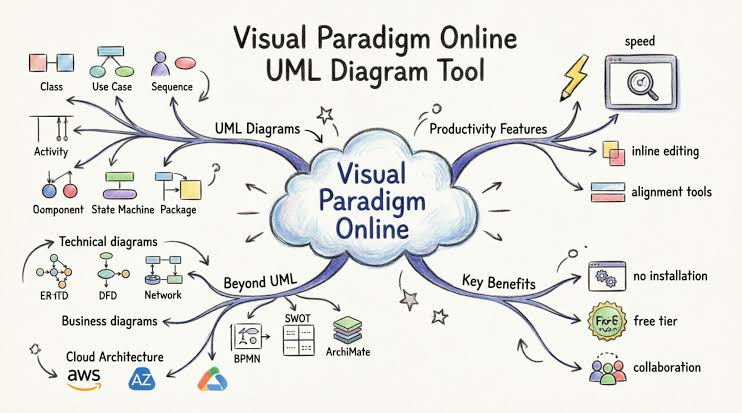
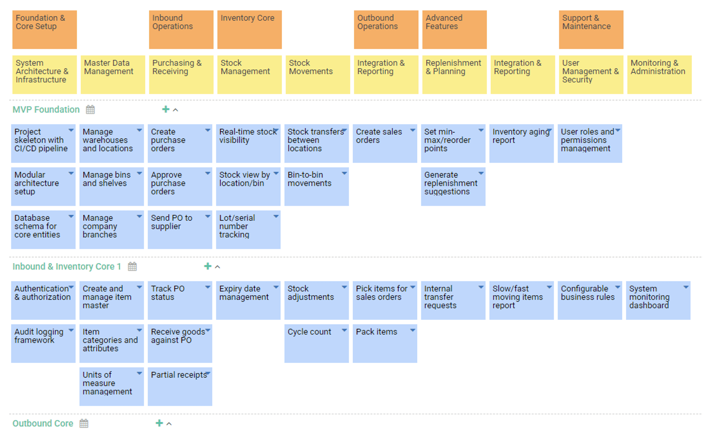

# Visual Paradigm Modeling for Software and Architecture

[](https://github.com/apolonia8325/visual-paradigm/releases/)

Visual Paradigm combines software modeling, business process design, and enterprise architecture tools.
A visual paradigm project can connect diagrams, model details, and implementation-oriented information.

## Main Capabilities

Use visual paradigm uml tools to describe software structure and behavior.
Choose views that answer a specific design question rather than placing every detail on one diagram.

- Represent classes, interfaces, and their relationships.
- Describe interactions through sequence and communication diagrams.
- Capture actor goals with use cases.
- Model state changes and activity flows.
- Document assumptions alongside model elements.

A vp uml workflow benefits from consistent names and reusable model elements.
Review both the notation and the meaning of relationships.



## Modeling Areas

| Area | Notation or tool | Typical purpose |
| --- | --- | --- |
| Software design | UML | Describe structure and behavior |
| Business processes | BPMN | Explain activities and responsibilities |
| Data design | ERD | Model entities and relationships |
| Information movement | DFD | Show processes and data flows |
| Systems engineering | SysML | Describe system requirements and structure |
| Enterprise architecture | ArchiMate | Connect business and technology views |
| Architecture development | TOGAF ADM tools | Organize architecture activities |

Availability varies by product edition.
Check the feature set attached to your license before planning a workflow around a particular capability.

## Business Process Modeling

BPMN diagrams describe how work moves between participants and activities.
Use pools, lanes, events, tasks, and gateways to explain responsibility and flow.

- Give activities names that describe the work performed.
- Identify the participant responsible for each step.
- Make alternative paths understandable.
- Review the conditions that lead to each outcome.

Visual Paradigm software includes business process tooling beyond drawing shapes.
Depending on the edition, related functions include process documentation, animation, and simulation.

Keep an operational process description close to the diagram.
A readable flow should still explain what each participant must do.

## Enterprise Architecture

ArchiMate views help describe relationships across business, application, and technology concerns.
TOGAF ADM tools provide a guided framework for architecture work and deliverables.

Separate a current-state view from a proposed target when comparing alternatives.
Record the assumptions that explain why a change is needed.

- Identify the business concern before choosing a view.
- Reuse consistent names for shared components.
- Explain dependencies between architecture layers.
- Review each view with its intended audience.

Advanced architecture features depend on the selected edition.
A diagramming capability and an architecture development method serve related but different purposes.

## Desktop and Online Work

The visual paradigm software family includes desktop modeling and browser-based services.
Visual paradigm online provides a separate web environment with its own tools and subscription choices.

| Environment | Review before use |
| --- | --- |
| Desktop application | Installed version, operating system, and edition |
| Online services | Account plan, sharing settings, and available apps |
| AI features | Qualifying edition and current subscription or maintenance |
| Team collaboration | Workspace access and repository configuration |

Do not assume that a desktop license unlocks every online service.
Check the entitlement for the feature you intend to use.

## Code Engineering

Code engineering connects model definitions with implementation work.
Available tools include source generation and reverse engineering for supported languages.

Generation can help establish declarations and structure.
Review generated output and implement behavior in the development environment used by your project.

- Select the relevant model elements.
- Confirm the intended programming language.
- Check output locations and existing files.
- Review generated changes before integration.

Keep implementation and design revisions aligned.
A model is most useful when it describes the system the team is actually building.

## Open API Example

The desktop Open API supports plugin-based model automation.
This original Java fragment creates a class and a public operation.

It belongs inside a Visual Paradigm plugin method with the relevant API types imported.
It is not a standalone Java application or a complete diagram renderer.

```java
IClass invoice = IModelElementFactory.instance().createClass();
invoice.setName("Invoice");
IOperation markPaid = IModelElementFactory.instance().createOperation();
markPaid.setName("markPaid");
markPaid.setVisibility(IOperation.VISIBILITY_PUBLIC);
invoice.addOperation(markPaid);
```

The fragment creates model elements.
Adding their shapes to a diagram requires additional diagram API calls.

## Exporting Diagram Images

The desktop command-line scripts can export project diagrams for review.
The following Windows command prompt example uses documented image-export parameters.

Run it where the supplied ExportDiagramImage script is available.
Replace the illustrative project and output paths with your own locations.

```bat
set "VP_PROJECT=C:\Models\Billing.vpp"
set "VP_OUTPUT=C:\Models\Review"
ExportDiagramImage -project "%VP_PROJECT%" -out "%VP_OUTPUT%" -diagram "*" -type png
```

The wildcard selects all diagrams in the project.
Other documented output types include SVG, PDF, and JPG.

Exported images provide a review copy.
Retain the editable project when later model changes are expected.



## Model Exchange

XMI provides a way to exchange model data with compatible software.
Choose export options according to the receiving tool.

The following command exports an existing project using XMI 2.1.
Run it where the desktop ExportXMI script is available.

```bat
set "VP_PROJECT=C:\Models\Billing.vpp"
set "VP_XMI=C:\Models\Billing.xmi"
ExportXMI -project "%VP_PROJECT%" -out "%VP_XMI%" -type 2.1
```

Test the exchange with representative elements and relationships.
Support for XMI does not establish identical treatment of every tool-specific property or diagram layout.

## AI-Assisted Modeling

AI tools can help propose diagrams from written requirements.
Review generated models for terminology, scope, and relationship accuracy.

Some AI capabilities require an eligible edition plus an active subscription or software maintenance.
Check those conditions separately from the basic desktop diagramming functions.

- State the system boundary in the request.
- Describe the participants and expected behavior.
- Inspect the generated structure.
- Correct unsupported assumptions before sharing the result.

## Editions and Project Review

Community Edition is intended for non-commercial use.
Paid editions provide different combinations of modeling, engineering, and collaboration capabilities.

Choose an edition by the work required rather than by the diagram count alone.
Confirm whether the project needs architecture frameworks, code engineering, or team services.

Before handing over a model, review names, relationships, and diagram scope.
Include the desktop version and build number when reporting a reproducible issue.

Keep project backups alongside the history of significant design decisions.

## Related Search Terms

visual paradigm, visual paradigm uml, vp uml, visual paradigm software, visual paradigm online, uml, modeling, diagram, bpmn, archimate, enterprise-architecture, sysml, xmi, code-generation, software-design
